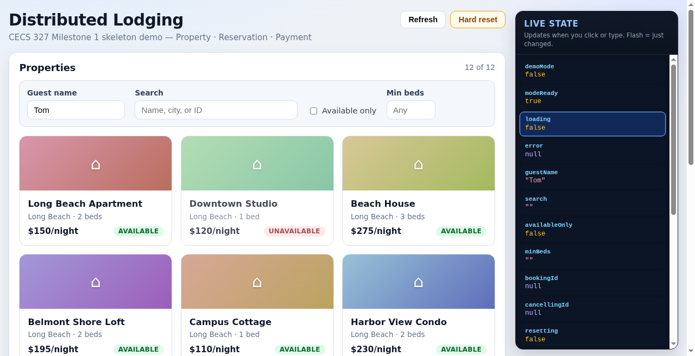

# CECS 327 Distributed Lodging, Milestone 2: Communication

CECS 327, Section 02, California State University, Long Beach.

**Team:** Hailey Clark, Josiah Guzman, Cameron Hill, Wasik Islam, Andrew Trujillo, Tom Malter, and Anthony Torres

A distributed lodging reservation system similar to Airbnb. This branch (`tom-react-frontend`) is the **live web version**: Node.js HTTP microservices with a React UI locally, and a Cloudflare Worker + D1 + Durable Object when hosted. The Python socket simulation of the same protocol is on [`main`](https://github.com/haileyc1201/CECS327-Distributed-Lodging/tree/main).

## What Milestone 2 Delivers

| Requirement | Local Node stack | Cloudflare Worker (hosted) |
|---|---|---|
| Marshalling / unmarshalling | Envelope ↔ JSON or typed XML (`Content-Type` selects the format); before/after logged. `services/shared/messaging.js` | Same format. `cloudflare/src/comm/marshal.ts` |
| RPC | JSON-RPC 2.0 over HTTP: `POST :8000/api/rpc` → Comm Hub `/rpc`. `services/comm-hub/server.js` | `POST /api/rpc`. `cloudflare/src/comm/routes.ts` |
| Request-reply | `availability.check`, `property.get`, `reservation.book` (Reservation → Property → Payment) | Same methods against D1 |
| Publish-subscribe (multiple subscribers) | `booking.created` → 3 subscriber processes (`services/comm-hub/node.js`) | `CommHub` Durable Object → 3 built-in subscribers + WebSocket subscribers (`/api/comm/ws?role=subscriber`). `cloudflare/src/comm/hub.ts` |
| Group communication (membership) | Group `property-replicas`, 3 replica processes: join/leave/view, numbered multicast with acks, failure detection | DO coordinator: mailbox members (`/api/group/*` + heartbeat lease) and WebSocket members (`/api/comm/ws?role=member`) |
| Timestamped logging | Every SEND/RECV in `logs/messages.jsonl`; `GET /api/comm/logs` | D1 table `message_log`; `GET /api/comm/logs?limit=&node=`. `cloudflare/src/comm/msglog.ts` |
| Demo + tests | `scripts/comm-demo.js`, `tests/comm.test.js` | `cloudflare/scripts/comm-demo.mjs` (20 checks) |

Booking flow: client → Reservation → Property (`availability.check`) → Payment → save → publish `booking.created` → multicast `availability_update` to `property-replicas` → reply listing `notified_subscribers` and `replicas_updated`.

### Ports (local)

| Component | Port |
|---|---|
| Property / Reservation / Payment | 5001 / 5002 / 5003 |
| Comm Hub (RPC, pub-sub, group) | 5010 |
| Subscribers: notification / analytics / audit | 5101 / 5102 / 5103 |
| Group members: replica-1 / -2 / -3 | 5201 / 5202 / 5203 |
| HTTP Gateway | 8000 |
| React (Vite) | 5173 |
| Worker (`wrangler dev`) | 8787 |

## Required Software

- Node.js 18+ and npm (local services and tests; tested on Node 20 and 22)
- Node.js 22+ for the Cloudflare Worker (Wrangler 4) and the hosted test script (it uses the global `WebSocket`)
- Optional: a Cloudflare account with `CLOUDFLARE_API_TOKEN` (or `npx wrangler login`) to deploy
- Git

## Install Dependencies

```bash
git clone https://github.com/haileyc1201/CECS327-Distributed-Lodging.git
cd CECS327-Distributed-Lodging
git checkout tom-react-frontend
npm run install:all              # root + frontend
npm install --prefix cloudflare  # Worker (Node 22+)
```

## Start Each Service

All at once: `./start-lodging.sh`. It starts the services, the hub, 3 subscribers, 3 replicas and the UI. To start them separately, use one terminal each:

```bash
npm run property      # :5001
npm run payment       # :5003
npm run hub           # :5010
npm run reservation   # :5002
npm run gateway       # :8000
node services/comm-hub/node.js subscriber notification-service 5101 booking.created
node services/comm-hub/node.js subscriber analytics-service    5102 booking.created
node services/comm-hub/node.js subscriber audit-service        5103 booking.created
node services/comm-hub/node.js member replica-1 5201 property-replicas
node services/comm-hub/node.js member replica-2 5202 property-replicas
node services/comm-hub/node.js member replica-3 5203 property-replicas
npm run frontend      # :5173
```

Worker locally:

```bash
npm run cf:build
cd cloudflare
npx wrangler d1 execute cecs327-lodging --local --file=schema.sql   # first time only
npx wrangler dev                                                    # http://127.0.0.1:8787
```

Example RPC call:

```bash
curl -s localhost:8000/api/rpc -H 'content-type: application/json' -d '{"id":"x1","type":"rpc.request","sender":"curl","receiver":null,"timestamp":"2026-10-12T00:00:00.000Z","correlation_id":null,"payload":{"jsonrpc":"2.0","method":"availability.check","params":{"property_id":101},"id":1}}'
```

## Run the Demo

```bash
npm run comm:demo
```

The local demo:

1. Starts all 11 processes.
2. Runs the JSON and XML marshalling round-trip.
3. Runs RPC request-reply, including an error case.
4. Books a property, which triggers pub-sub to 3 subscribers and a multicast to 3 replicas.
5. Shows a double booking being rejected.
6. Kills replica-3 to show failure detection.
7. Prints subscriber and replica state and `/api/comm/logs`.

Hosted/Worker demo:

```bash
BASE_URL=http://127.0.0.1:8787 npm run cf:test           # against wrangler dev
BASE_URL=https://lodging.pitchblack.icu npm run cf:test  # against the deployed Worker
```

> **Deploy status:** **deployed** on 2026-10-12 at about 4:40 PM PT (Worker version `130a49b4-4b81-41b5-a1e1-cb74e8227111`). Live at **https://lodging.pitchblack.icu** (also https://pitchblack.icu). The hosted test suite passes 20/20 against the live URL: `BASE_URL=https://lodging.pitchblack.icu npm run cf:test` (screenshots 12–13).

## Test Cases

```bash
npm test                                         # Node: node:test, 7 tests
BASE_URL=http://127.0.0.1:8787 npm run cf:test   # Worker: 20 checks
```

| # | Test case | Node | Worker |
|---|---|---|---|
| TC1 | JSON and XML marshal/unmarshal round-trip keeps types; ISO-8601 timestamp | ✓ | XML reply checked |
| TC2 | Request-reply `availability.check` / `property.get` in JSON and XML; 404 and -32601 errors | ✓ | ✓ |
| TC3 | Booking notifies all subscribers and multicasts to all replicas; double booking rejected | ✓ (3 + 3) | ✓ (3 built-in + 2 WS subscribers; 2 mailbox + 1 WS replica) |
| TC4 | Group failure detection, graceful leave, view update | ✓ | ✓ (closed WebSocket member removed) |
| TC5 | Pub-sub topic filtering | ✓ | n/a |
| TC6 | Every log entry ISO-8601; before/after marshalling; `/api/comm/logs` | ✓ | ✓ |

Latest results: Node 7/7 pass; Worker 20/20 checks pass under `wrangler dev` and against the live https://lodging.pitchblack.icu.

## Report and Logs

- **Report (PDF):** [`docs/milestone-2/CECS327_Milestone2_Communication_Report.pdf`](docs/milestone-2/CECS327_Milestone2_Communication_Report.pdf) ([markdown source](docs/milestone-2/CECS327_Milestone2_Communication_Report.md)). It covers the communication model, message formats, marshalling, why sockets/RPC, the pub-sub and group designs, a side-by-side comparison of the Python and web/Cloudflare paths, and real log excerpts.
- **Logs from real runs:** [`docs/logs/`](docs/logs)
  - `python-messages.jsonl`, `python-demo-output.txt`, `python-test-results.txt`: Python simulation (`main`)
  - `node-messages.jsonl`, `node-demo-output.txt`, `node-test-results.txt`: Node stack (`tom-react-frontend`)
  - `worker-local-messages.jsonl`, `worker-local-demo-output.txt`: Cloudflare Worker under `wrangler dev`
- Runtime logs are written to `logs/messages.jsonl` (git-ignored).
- No video for this milestone.

## Screenshots

These are from real runs; all files are in [`docs/milestone-2/screenshots/`](docs/milestone-2/screenshots).

| # | Screenshot |
|---|---|
| 01 | [Python demo, full run (10 processes)](docs/milestone-2/screenshots/01_python_demo_full_run.png) |
| 02 | [Request-reply: JSON-RPC over TCP](docs/milestone-2/screenshots/02_request_reply_jsonrpc_tcp.png) |
| 03 | [Marshalling before/after (JSON + XML)](docs/milestone-2/screenshots/03_marshalling_before_after.png) |
| 04 | [Pub-sub: booking.created to 3 subscribers](docs/milestone-2/screenshots/04_pubsub_three_subscribers.png) |
| 05 | [Group communication: multicast, acks, membership, failure](docs/milestone-2/screenshots/05_group_multicast_membership.png) |
| 06 | [ISO-8601 timestamped messages.jsonl](docs/milestone-2/screenshots/06_timestamped_message_log.png) |
| 07 | [Python tests (10/10)](docs/milestone-2/screenshots/07_python_tests_passing.png) |
| 08 | [Node comm demo](docs/milestone-2/screenshots/08_node_comm_demo.png) |
| 09 | [Node tests (7/7)](docs/milestone-2/screenshots/09_node_tests_passing.png) |
| 10a | [Worker under wrangler dev: 20/20 checks](docs/milestone-2/screenshots/10a_worker_local_tests.png) |
| 10b | [Worker GET /api/comm/logs JSON](docs/milestone-2/screenshots/10b_worker_comm_logs_json.png) |
| 11 | [React UI (local stack) after a booking made through /api/rpc](docs/milestone-2/screenshots/11_react_ui.png) |
| 12 | [LIVE Worker at lodging.pitchblack.icu: 20/20 checks](docs/milestone-2/screenshots/12_live_worker_tests.png) |
| 13 | [LIVE GET /api/comm/logs JSON](docs/milestone-2/screenshots/13_live_worker_comm_logs.png) |

## Contribution Table

| Member | Milestone 2 contribution |
|---|---|
| _Member 1_ | _TBD_ |
| _Member 2_ | _TBD_ |
| _Member 3_ | _TBD_ |
| _Member 4_ | _TBD_ |
| _Member 5_ | _TBD_ |
| _Member 6_ | _TBD_ |
| _Member 7_ | _TBD_ |

_Fill in names and contributions before submitting._

## Milestone 1 (previous)

Milestone 1 built Property, Reservation and Payment as Node HTTP services behind an Express gateway, with a React UI. Data is in `data/*.csv`. The original Python TCP services are archived in `archive/python-tcp/`. Milestone 1 also added a Cloudflare Worker + D1 host with the same `/api/*` contract.

The site (now running the Milestone 2 build) is live at:

- https://lodging.pitchblack.icu (also https://pitchblack.icu, https://www.pitchblack.icu)
- https://cecs327-lodging.tommalter5.workers.dev

Features: search, book/cancel with mock payment and refund, hard reset (`POST /api/reset`), colorized service logs, and a React state panel. The design docs are in `docs/milestone-1/`.

[](https://lodging.pitchblack.icu)

Cloudflare notes:

- The Worker is `cecs327-lodging` and uses the D1 database `cecs327-lodging`. Its config is in `cloudflare/wrangler.toml`, including the `COMM_HUB` Durable Object.
- Build and deploy with `npm run cf:deploy` (Node 22+).
- Preview locally with `npm run cf:dev`.

## Repository Structure

```text
.
├── services/
│   ├── shared/messaging.js   # M2 envelope, marshalling, logging
│   ├── comm-hub/             # M2 RPC + pub-sub + group hub, subscriber/member nodes
│   ├── property-service/  reservation-service/  payment-service/  gateway/
├── cloudflare/
│   ├── src/comm/             # M2 marshal, msglog (D1), CommHub DO, routes
│   ├── src/services/         # property / payment / reservation modules
│   ├── scripts/comm-demo.mjs
│   ├── wrangler.toml  schema.sql
├── frontend/                 # React + Vite UI
├── scripts/                  # comm-demo.js, comm-cluster.js
├── tests/comm.test.js
├── docs/milestone-1/  docs/milestone-2/  docs/logs/
├── archive/python-tcp/
├── data/  logs/  screenshots/
├── package.json  start-lodging.sh
```

## Working on the Project

```bash
git pull
git checkout -b yourname-task
git add . && git commit -m "Describe what you changed"
git push -u origin yourname-task   # then open a pull request
```
