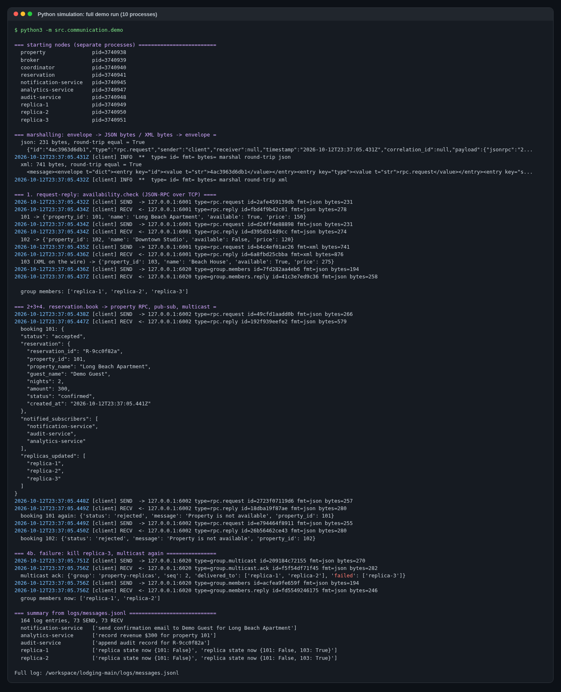
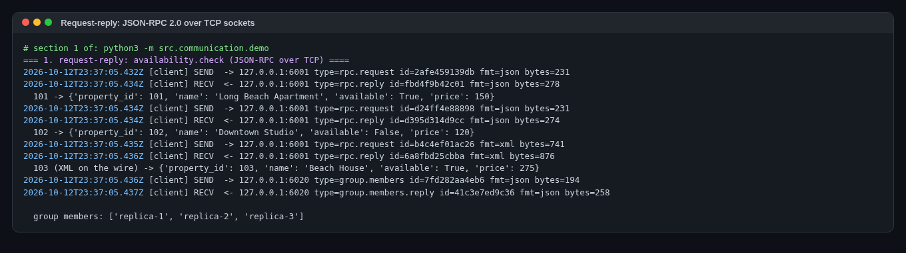
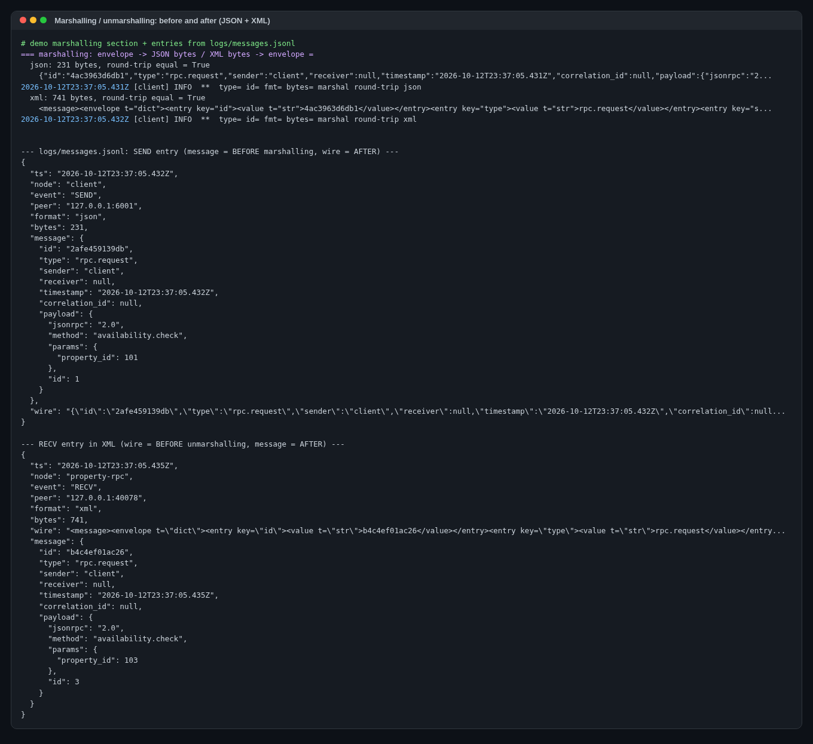
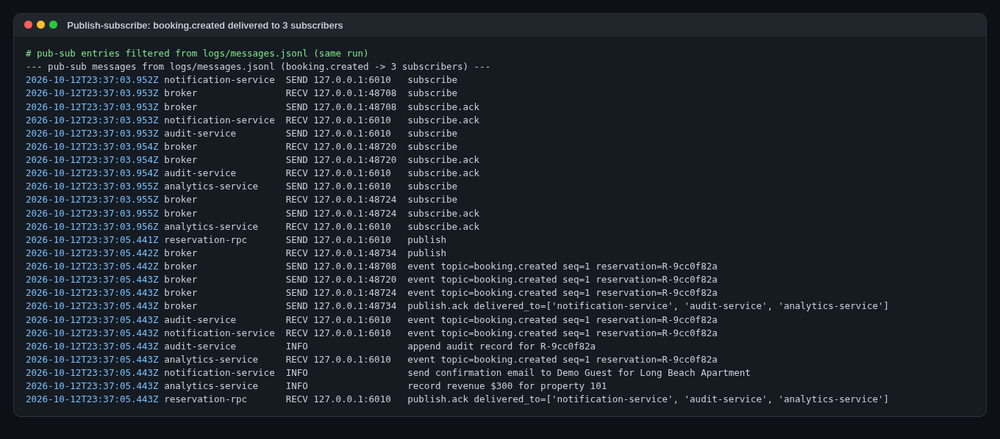
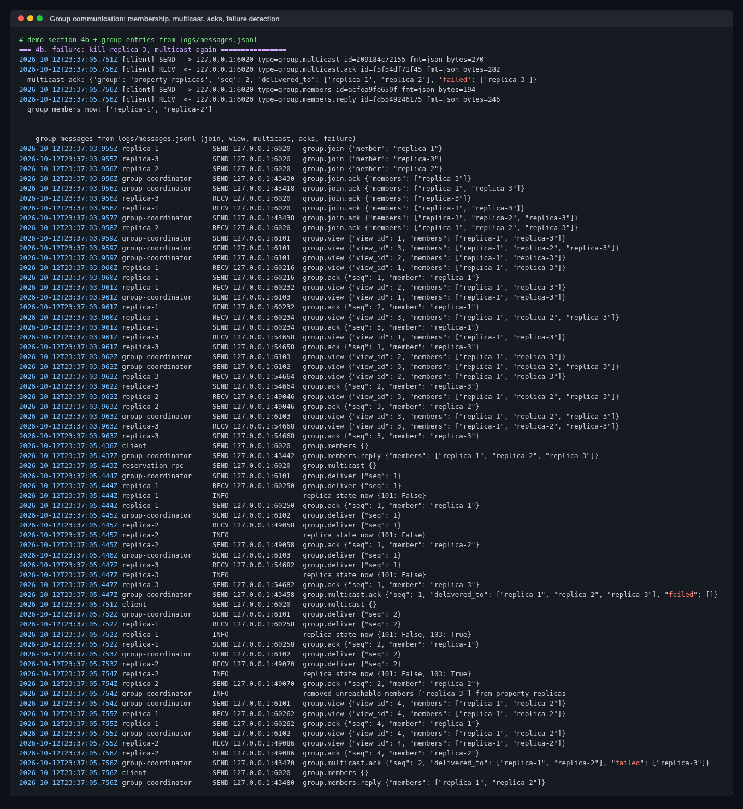
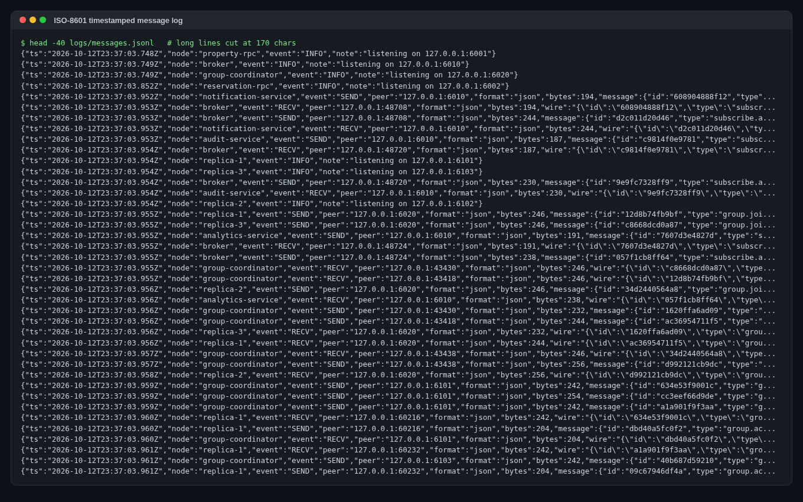
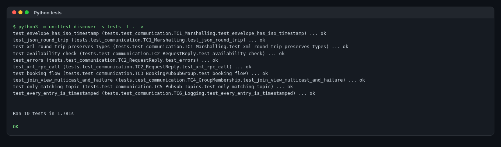

# CECS 327 Distributed Lodging — Milestone 2: Communication Mechanisms Report

**Course:** CECS 327, Section 02, CSULB  **Repository:** https://github.com/haileyc1201/CECS327-Distributed-Lodging
**Branch:** `main` (Python simulation)

## 1. Overview

The Python simulation on `main` uses the message envelope and wire formats described below.

* Each node is its own OS process: Property RPC, Reservation RPC, a pub-sub Broker, a Group Coordinator, 3 subscriber services and 3 property replicas. They talk over **raw TCP sockets** with length-prefixed frames carrying **JSON-RPC 2.0** and event messages. It builds on Hailey's Milestone 1 Property/Reservation socket services and the same `data/properties.json`. Her original services and client still run unchanged.

## 2. Communication model

| Aspect | Python simulation (`main`) |
|---|---|
| Transport | TCP sockets (`socket` module), 4-byte length + 1-byte format header per frame |
| Processes / nodes | 10 OS processes: property-rpc :6001, reservation-rpc :6002, broker :6010, group-coordinator :6020, 3 subscribers, 3 replicas :6101-6103 |
| Synchronous style | Blocking request-reply on a persistent socket |
| Asynchronous style | Broker pushes `event` frames over long-lived subscriber sockets |
| Shared state | In-memory per node; property data from `data/properties.json` (not modified by demo) |

Booking flow: **client → Reservation (RPC) → Property `availability.check` (request-reply) → mark unavailable → publish `booking.created` (pub-sub) → multicast `availability_update` to group `property-replicas` (group communication) → reply to client** listing which subscribers and replicas were reached.

## 3. Message formats

Every message is an **envelope**:

```json
{
  "id": "fc94cb9cacac",
  "type": "rpc.request",
  "sender": "client",
  "receiver": null,
  "timestamp": "2026-10-12T23:16:20.185Z",
  "correlation_id": null,
  "payload": {"jsonrpc": "2.0", "method": "reservation.book",
              "params": {"property_id": 101, "guest_name": "Demo Guest", "nights": 2}, "id": 3}
}
```

The reply carries `correlation_id` = the request's `id`, which lets clients match replies to requests:

```json
{"id":"a13de2f6078d","type":"rpc.reply","sender":"reservation-rpc","receiver":"client",
 "timestamp":"2026-10-12T23:16:20.195Z","correlation_id":"fc94cb9cacac",
 "payload":{"jsonrpc":"2.0","id":3,"result":{"status":"accepted",
   "reservation":{"reservation_id":"R-27d48c43","property_id":101,"amount":300,"status":"confirmed"},
   "notified_subscribers":["notification-service","analytics-service","audit-service"],
   "replicas_updated":["replica-1","replica-2","replica-3"]}}}
```

Pub-sub event and group multicast payloads:

```json
{"type":"event","sender":"broker","payload":{"topic":"booking.created","seq":1,
  "publisher":"reservation-rpc","event":{"reservation_id":"R-27d48c43","property_id":101,"amount":300}}}

{"type":"group.deliver","sender":"group-coordinator","receiver":"replica-2","payload":{
  "group":"property-replicas","seq":1,"origin":"reservation-rpc",
  "message":{"op":"availability_update","property_id":101,"available":false}}}
```

Message types: `rpc.request`/`rpc.reply`, `subscribe`/`subscribe.ack`, `publish`/`publish.ack`, `event`/`event.ack`, `group.join`/`group.leave`/`group.members`/`group.multicast` (+ `.ack`/`.reply`), `group.deliver`, `group.view`, `group.ack`, `group.heartbeat`.

**Second format: typed XML.** The same envelope can be sent as XML. Each element carries a type attribute (`t="int|float|bool|str|null|dict|list"`), so the round-trip is lossless:

```xml
<message><envelope t="dict"><entry key="id"><value t="str">9aee0f075a81</value></entry>
<entry key="type"><value t="str">rpc.request</value></entry> ...
<entry key="payload"><value t="dict"><entry key="params"><value t="dict">
<entry key="property_id"><value t="int">103</value></entry></value></entry></value></entry></envelope></message>
```

## 4. Marshalling and unmarshalling

| Step | Python (`src/communication/codec.py`, `transport.py`) |
|---|---|
| Marshal | `marshal(envelope, "json"/"xml")` → UTF-8 bytes (`json.dumps` / ElementTree) |
| Framing | `[len:4][fmt:'J'/'X'][body]`. Removes Milestone 1's 1024-byte `recv` limit and allows many messages per connection |
| Unmarshal | `recv_exact` header → body → `unmarshal(body, fmt)` → dict |
| Before/after logging | Each SEND log stores `message` (before) and `wire` (after). Each RECV log stores `wire` (before) and `message` (after) |

## 5. Why sockets / RPC

| | TCP sockets + JSON-RPC 2.0 |
|---|---|
| Reason | Milestone 1 already used TCP sockets. Sockets show the low-level mechanics the course covers (connect, framing, blocking request-reply). JSON-RPC adds a standard method/params/error contract instead of ad-hoc `action` strings |
| Errors | JSON-RPC codes: -32600 invalid request, -32601 method not found, -32602 bad params, 404 property not found |
| Methods | `rpc.ping`, `property.list/get`, `availability.check`, `property.set_available`, `reservation.book/get/list` |

RMI was not chosen because it is Java-specific, and the team's stack is Python.

## 6. Publish-subscribe design

| | Python |
|---|---|
| Broker | `Broker` process :6010 |
| Subscribe | `subscribe {topics}` on a long-lived socket |
| Subscribers in demo | notification-, analytics-, audit-service (3 processes) |
| Publish | Reservation sends `publish` → broker fans out `event` (with seq) to each subscriber → `publish.ack {delivered_to, failed}` |
| Decoupling / failure | Publisher does not know the subscribers. A broken socket is removed |

Topic filtering is tested: a publish on `other.topic` reaches nobody.

## 7. Group communication design

| | Python |
|---|---|
| Coordinator | `GroupCoordinator` :6020 |
| Members | replica-1..3, each with its own TCP listener |
| Membership ops | `group.join/leave/members`; every change → `group.view {view_id, members}` to all |
| Multicast | Coordinator sends a numbered `group.deliver` to every member and waits for `group.ack`. Replies `{seq, delivered_to, failed}` |
| Failure detection | Unreachable member (refused, closed or timed-out connection) is logged as an INFO `delivery ... failed` entry, removed, and a new view announced |
| Use | Keep property availability caches consistent across replicas |

The demo kills `replica-3`. The next multicast reports `failed: ["replica-3"]` and the membership view shrinks.

## 8. Logging

Every SEND and RECV on every node is logged with an ISO-8601 UTC timestamp (millisecond precision, `Z`):

* `logs/messages.jsonl` (`COMM_LOG_FILE` overrides the path), plus readable stdout lines.

## 9. Log excerpts from real runs

All excerpts were copied from runs on 2026-10-12. The full logs are in `docs/logs/`.

### 9.1 Python simulation (`python -m src.communication.demo`)
```
=== 2+3+4. reservation.book -> property RPC, pub-sub, multicast =
2026-10-12T23:16:55.257Z [client] SEND  -> 127.0.0.1:6002 type=rpc.request id=8ef12977323e fmt=json bytes=266 
2026-10-12T23:16:55.266Z [client] RECV  <- 127.0.0.1:6002 type=rpc.reply id=2a0f976ce60b fmt=json bytes=579 
  booking 101: {
  "status": "accepted",
  "reservation": {
    "reservation_id": "R-fa7a220d",
    "property_id": 101,
    "property_name": "Long Beach Apartment",
    "guest_name": "Demo Guest",
    "nights": 2,
    "amount": 300,
    "status": "confirmed",
    "created_at": "2026-10-12T23:16:55.260Z"
...
=== 4b. failure: kill replica-3, multicast again ================
2026-10-12T23:16:55.571Z [client] SEND  -> 127.0.0.1:6020 type=group.multicast id=c308b7a43408 fmt=json bytes=270 
2026-10-12T23:16:55.576Z [client] RECV  <- 127.0.0.1:6020 type=group.multicast.ack id=906842448018 fmt=json bytes=282 
  multicast ack: {'group': 'property-replicas', 'seq': 2, 'delivered_to': ['replica-1', 'replica-2'], 'failed': ['replica-3']}
2026-10-12T23:16:55.576Z [client] SEND  -> 127.0.0.1:6020 type=group.members id=de9e1fae51be fmt=json bytes=194 
2026-10-12T23:16:55.577Z [client] RECV  <- 127.0.0.1:6020 type=group.members.reply id=5cb1ab2d7a2f fmt=json bytes=246 
  group members now: ['replica-1', 'replica-2']

=== summary from logs/messages.jsonl ============================
  164 log entries, 73 SEND, 73 RECV
  notification-service   ['send confirmation email to Demo Guest for Long Beach Apartment']
  analytics-service      ['record revenue $300 for property 101']
  audit-service          ['append audit record for R-fa7a220d']
  replica-1              ['replica state now {101: False}', 'replica state now {101: False, 103: True}']
  replica-2              ['replica state now {101: False}', 'replica state now {101: False, 103: True}']

```
One SEND entry (booking request) with before/after marshalling:
```json
{
 "ts": "2026-10-12T23:16:55.257Z",
 "node": "client",
 "event": "SEND",
 "peer": "127.0.0.1:6002",
 "format": "json",
 "bytes": 266,
 "message": {
  "id": "8ef12977323e",
  "type": "rpc.request",
  "sender": "client",
  "receiver": null,
  "timestamp": "2026-10-12T23:16:55.257Z",
  "correlation_id": null,
  "payload": {
   "jsonrpc": "2.0",
   "method": "reservation.book",
   "params": {
    "property_id": 101,
    "guest_name": "Demo Guest",
    "nights": 2
   },
   "id": 4
  }
 },
 "wire": "{\"id\":\"8ef12977323e\",\"type\":\"rpc.request\",\"sender\":\"client\",\"receiver\":null,\"timestamp\":\"2026-10-12T23:16:55.257Z\",\"correlation_id\":null,\"payload\":{\"jsonrpc\":\"2.0\",\"method\":\"reservation.book\",\"params\":{\"property_id\":101,\"guest_name\":\"Demo Guest\",\"nights\":2},\"id\":4}}"
}
```

## 10. Test cases

| # | Test case | Python (`python -m unittest discover -s tests -t . -v`) |
|---|---|---|
| TC1 | JSON + XML marshal round-trip, ISO timestamp | pass |
| TC2 | Request-reply availability.check / property.get, JSON and XML, error codes | pass |
| TC3 | Booking → 3 subscribers notified + 3 replicas updated; double booking rejected | pass |
| TC4 | Group join/view/multicast; failure removes member; leave | pass |
| TC5 | Pub-sub topic filtering | pass |
| TC6 | Every log entry ISO-8601; SEND entries have before/after | pass |

Results: Python **Ran 10 tests — OK**. The raw output is in `docs/logs/python-test-results.txt`.

## 12. Screenshots

All screenshots come from real runs on 2026-10-12. Terminal output was rendered to PNG. The files are in `docs/milestone-2/screenshots/`.

**Figure 01: Python demo, full run (10 processes)**



**Figure 02: Request-reply: JSON-RPC over TCP**



**Figure 03: Marshalling before/after (JSON + XML)**



**Figure 04: Pub-sub: booking.created to 3 subscribers**



**Figure 05: Group communication: multicast, acks, membership, failure**



**Figure 06: ISO-8601 timestamped messages.jsonl**



**Figure 07: Python tests (10/10)**



## 13. Contribution table

| Member | Contribution (communication milestone) |
|---|---|
| _Member 1_ | _TBD_ |
| _Member 2_ | _TBD_ |
| _Member 3_ | _TBD_ |
| _Member 4_ | _TBD_ |
| _Member 5_ | _TBD_ |
| _Member 6_ | _TBD_ |
| _Member 7_ | _TBD_ |

_Fill in names and contributions before submitting._
